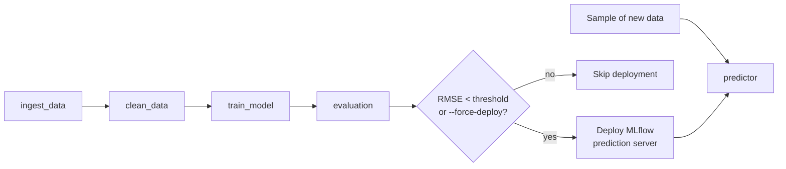
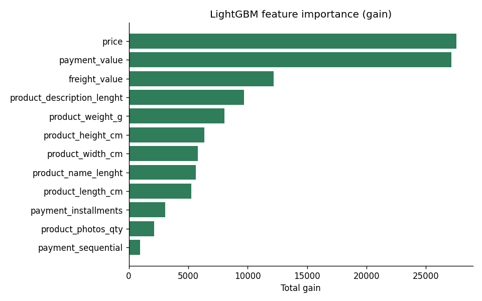

# Customer Satisfaction MLOps Pipeline

Predicts the review score (1–5) a customer will give an order, using an end-to-end MLOps pipeline built with **ZenML** and **MLflow**. The pipeline ingests and cleans data, trains a model, evaluates it, and deploys it as a REST prediction service only if it meets an RMSE threshold.

**Dataset:** [Brazilian E-Commerce Public Dataset by Olist](https://www.kaggle.com/datasets/olistbr/brazilian-ecommerce): about 100,000 orders from 2016–2018 with payment, freight, product and review information.

## Tech stack

Python 3.12 · ZenML · MLflow · LightGBM · scikit-learn · pandas · Streamlit

## Pipelines



### Training pipeline: `run_pipeline.py`

| Step | What it does |
| --- | --- |
| `ingest_data` | Loads `data/olist_customers_dataset.csv` |
| `clean_data` | Drops date columns, fills missing values with medians, keeps numeric features, 80/20 train/test split |
| `train_model` | Trains a LightGBM regressor and logs it to MLflow as `model` |
| `evaluation` | Computes MSE, RMSE and R² and logs them to MLflow |

### Continuous deployment pipeline: `run_deployment.py`

Runs the training steps, then:

| Step | What it does |
| --- | --- |
| `deployment_trigger` | Approves deployment if RMSE is below `--min-accuracy` (default `2.0`) |
| `combine_decision` | Lets `--force-deploy` override the threshold |
| `mlflow_model_deployer_step` | Serves the model as a local MLflow prediction service |

The **inference pipeline** loads the running service and predicts on a fresh sample of 100 rows.

### Windows-compatible deployment: `run_custom_deployment.py`

ZenML's MLflow deployer runs the server as a background daemon, which doesn't work on Windows. This pipeline uses custom steps instead:

- `custom_mlflow_deployer` looks up the latest registered model, writes `start_mlflow_server.bat` and starts `mlflow models serve` in a new window.
- `custom_mlflow_predictor` sends batches to the `/invocations` REST endpoint, retrying with backoff.

## Setup

```powershell
python -m venv venv
venv\Scripts\Activate.ps1
pip install -r requirements.txt

zenml init
zenml integration install mlflow -y
zenml experiment-tracker register mlflow_tracker --flavor=mlflow
zenml model-deployer register mlflow --flavor=mlflow
zenml stack register mlflow_stack -a default -o default -d mlflow -e mlflow_tracker --set
```

## Usage

**Train and evaluate**
```powershell
python run_pipeline.py
```

**Train, deploy and predict (Linux / macOS)**
```powershell
python run_deployment.py --config deploy_and_predict
python run_deployment.py --config deploy --force-deploy   # skip the RMSE gate
```

**Train, deploy and predict (Windows)**
```powershell
python run_custom_deployment.py --config deploy_and_predict --port 5000
python run_custom_deployment.py --config predict --endpoint http://127.0.0.1:5000/invocations
```

**Serve a logged model directly and send test requests**
```powershell
python manual_serve.py   # set model_path in the script first
```

**Inspect experiments**
```powershell
mlflow ui --backend-store-uri "<tracking-uri printed by the pipeline>"
```

**Streamlit app**
```powershell
streamlit run streamlit_app.py
```

## Calling the prediction endpoint

```http
POST http://127.0.0.1:5000/invocations
Content-Type: application/json

{
  "dataframe_split": {
    "columns": ["payment_sequential", "payment_installments", "payment_value", "price",
                "freight_value", "product_name_lenght", "product_description_lenght",
                "product_photos_qty", "product_weight_g", "product_length_cm",
                "product_height_cm", "product_width_cm"],
    "data": [[1, 3, 142.9, 129.9, 13.0, 50, 600, 2, 800, 30, 15, 20]]
  }
}
```

The response is `{"predictions": [...]}`, one predicted score per row.

## Results

LightGBM regressor on the 20% hold-out set:

| Metric | Value |
| --- | --- |
| MSE | 1.739 |
| RMSE | 1.319 |
| R² | 0.083 |

RMSE is well under the default deployment threshold of 2.0, so the model is deployed automatically. The low R² shows that order and product attributes alone explain little of the variation in review scores.



Price, payment value and freight value carry most of the predictive signal.

## Project structure

```
├── data/                      # Olist dataset (CSV)
├── model/                     # Data cleaning, model and evaluation strategy classes
├── steps/                     # ZenML steps (ingest, clean, train, evaluate, custom deploy/predict)
├── pipelines/                 # Training, deployment and inference pipelines
├── materializer/              # Custom ZenML materializer for models and DataFrames
├── _assets/                   # Feature importance chart
├── saved_model/               # Pickled trained LightGBM model
├── run_pipeline.py            # Training entry point
├── run_deployment.py          # ZenML MLflow deployment entry point
├── run_custom_deployment.py   # Windows-compatible deployment entry point
├── manual_serve.py            # Serve a logged model and test it
├── streamlit_app.py           # Web UI for predictions
└── tests/                     # Data shape, leakage and target range checks
```
